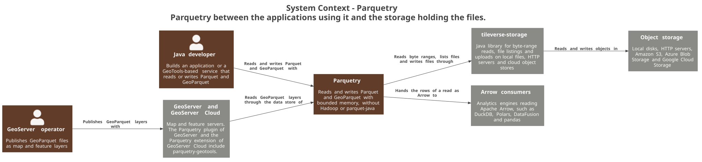

# Parquetry documentation

This directory holds the sources of the Parquetry documentation site, published at [parquetry.io](https://parquetry.io). The site is built with [Zensical](https://zensical.org), the successor of Material for MkDocs. Zensical reads the `mkdocs.yml` configuration. The architecture diagrams are generated from a Structurizr DSL.

## Quick start

```bash
# One-time setup and build: creates .venv, generates the diagrams, builds the site
./build.sh

# Auto-reloading server at http://127.0.0.1:8000
./serve.sh

# Remove the built site and the generated diagrams
./clean.sh
```

## Requirements

- Python 3.11 or newer, as required by Zensical
- Docker, for the Structurizr and PlantUML images
- Internet access on the first run, to pull the Docker images

## Directory layout

```
docs/
  build.sh              # end-to-end build: venv + diagrams + site
  serve.sh              # live development server
  clean.sh              # removes site/ and the generated diagrams
  requirements.txt      # Python dependencies (Zensical)
  mkdocs.yml            # site configuration and navigation, read by Zensical
  overrides/            # theme template overrides (favicon links, analytics without a key)
  src/                  # Markdown sources (docs_dir in mkdocs.yml)
    index.md            # home page
    why.md              # who Parquetry is for, and when not to use it
    getting-started.md  # dependency, JVM flags and a first read
    guides/             # task pages: how to do one thing
    geoserver/          # GeoTools and GeoServer
    cli/                # the par command line tool
    experimental/       # Iceberg and STAC GeoParquet
    concepts/           # "Under the hood": how and why it works
    reference/          # modules and format support
    developer-guide/    # build, architecture, releases, contributing
    assets/
      images/           # logo, banner, favicon
        structurizr/    # generated C4 diagrams (not committed)
      stylesheets/
  structurizr/          # C4 model source
    workspace.dsl       # the Parquetry software system and its static views
    dynamic-views.dsl   # the dynamic views, extending workspace.dsl
    exports/            # generated PlantUML (not committed)
    structurizr-generate-diagrams.sh
    plantuml-generate-svg.sh
```

`site/` is generated by the build and is not committed.

## Build process

`build.sh` runs three steps:

1. **Python environment.** It creates `.venv/` if missing and installs `requirements.txt`.
2. **Diagrams.** It runs the Structurizr Docker image against `structurizr/workspace.dsl` and `structurizr/dynamic-views.dsl` to export PlantUML, then renders the PlantUML files to SVG under `src/assets/images/structurizr/`.
3. **Site.** `zensical build --clean --strict` writes the static site to `site/`. A link to a missing page or to a missing anchor fails the build.

Google Analytics reads its measurement ID from the environment variable `GOOGLE_ANALYTICS_KEY`. The deploy job sets it from the repository variable of the same name. A build without it, such as a local or pull request build, produces pages without analytics.

## C4 diagrams

`structurizr/workspace.dsl` models Parquetry as one software system, with its static views. `structurizr/dynamic-views.dsl` extends that workspace with the dynamic views. Each view has a key, and the build renders it to `src/assets/images/structurizr/structurizr-<ViewKey>.svg`. The developer guide page `src/developer-guide/architecture.md` shows the diagrams.

| View key | What it shows |
| :--- | :--- |
| `SystemContext` | Parquetry between the applications using it and the storage holding the files |
| `Containers` | The modules of Parquetry and the Maven dependencies between them |
| `CoreComponents` | The read pipeline and the writer of `parquetry-core` |
| `CatalogComponents` | The catalogs and datasets of `parquetry-catalog` |
| `GeoToolsComponents` | The GeoTools data store of `parquetry-geotools` |
| `FilteredRead` | A filtered read of one file, step by step (dynamic view) |
| `GeoServerRequest` | A GeoServer WMS or WFS request reaching a GeoParquet file (dynamic view) |

To add a diagram, add a view to `workspace.dsl`, or a dynamic view to `dynamic-views.dsl`, run `./build.sh`, and embed the SVG on a page:

```markdown

```

## Brand assets

The colors and the logo come from the Parquetry brand identity. `src/assets/stylesheets/extra.css` defines the palette and lists the contrast ratio of each text and background pair.

| File under `src/assets/images/` | What it is |
| :--- | :--- |
| `parquetry_banner.svg` | The banner of the home page and of the repository README |
| `parquetry_logo.svg` | The square logo with the wordmark |
| `parquetry-mark.svg` | The diamond mark alone, shown in the site header |
| `favicon.svg` | The mark on a brown rounded square |
| `favicon-16.svg` | A simplified mark, because the fine lines blur at 16 pixels |
| `favicon.ico` | 16, 32 and 48 pixel layers |
| `apple-touch-icon.png` | 180 pixels, square corners |

`favicon.ico` and `apple-touch-icon.png` are derived files. Regenerate them after changing an SVG, from `src/assets/images/`:

```bash
rsvg-convert -w 16 -h 16 favicon-16.svg -o /tmp/favicon-16.png
rsvg-convert -w 32 -h 32 favicon.svg -o /tmp/favicon-32.png
rsvg-convert -w 48 -h 48 favicon.svg -o /tmp/favicon-48.png
magick /tmp/favicon-16.png /tmp/favicon-32.png /tmp/favicon-48.png favicon.ico

# The touch icon has square corners: iOS rounds them itself.
sed -E 's/ rx="51" ry="51"//' favicon.svg > /tmp/touch.svg
rsvg-convert -w 180 -h 180 /tmp/touch.svg -o apple-touch-icon.png
```

## Writing pages

The site is organized by what the reader is doing, not by module. A guide shows how to do one task. A page of the "Under the hood" section, under `src/concepts/`, explains how something works and why. Keep a page to one of the two, and link between them.

- **Each fact lives on one page.** Other pages link to it.
- **Samples match the source.** Compile each Java sample against `main` before committing it. Use explicit types, not `var`, and show the imports.
- **Plain prose.** Short declarative sentences. No superlatives and no marketing words.
- **Other projects are described by what they give their users.** A comparison appears only where it explains a design constraint of Parquetry. A statement about another project names the version it was checked against.
- **Storage and caching.** Pages state the Parquetry facts and link to [tileverse.io](https://tileverse.io) for tileverse-storage behavior.
- **ASCII only.** Plain hyphens and straight quotes. No decorative emoji.

To add a page:

1. Add the file under `src/` in the section it belongs to.
2. Add it to the `nav:` block of `mkdocs.yml`.
3. Link to it from at least one neighboring page.
4. Run `./serve.sh` and read the page in the browser.
