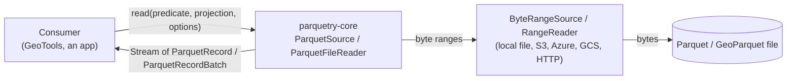
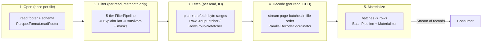
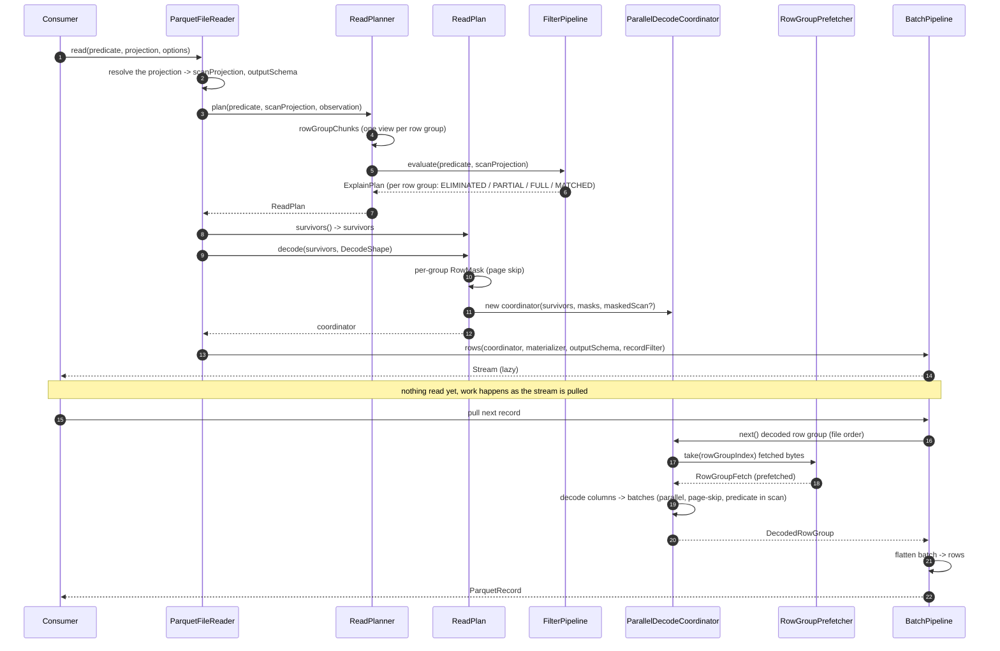
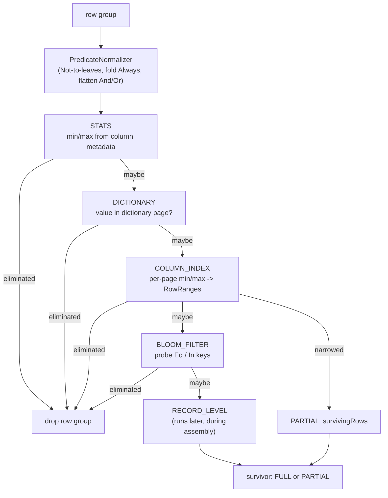
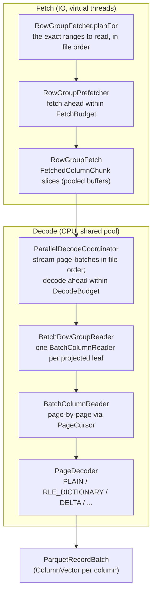
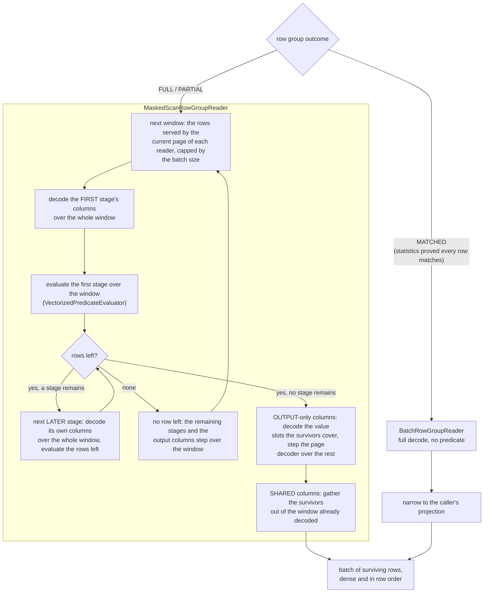
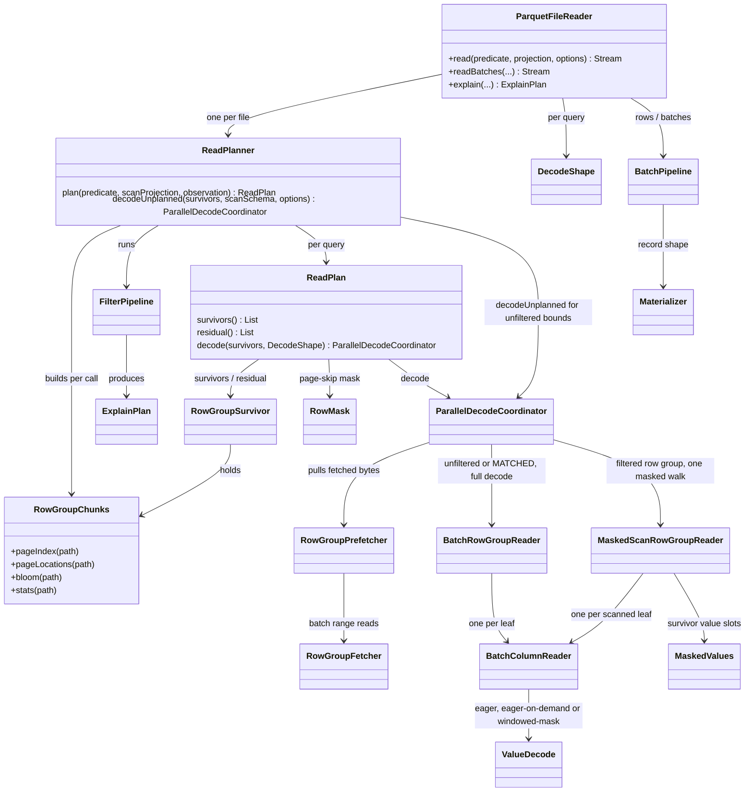

# The parquetry read path

How a `read()` turns a Parquet file on some byte source into a stream of records,
explained from the top down. Each section zooms in one level; stop wherever you
have enough detail. Diagrams are [Mermaid](https://mermaid.js.org/) and render on
GitHub.

The guiding principle never changes: **filter, then fetch, then decode, then
materialize.** Everything below is detail hanging on those four verbs.

---

## 1. System context

What talks to what. `parquetry-core` reads one file; it does not own the bytes or
the threads the consumer runs on.

- The consumer passes a **predicate** (what rows), a **projection** (what
  columns), and **ReadOptions** (tunables), and gets back a lazy `Stream`.
- parquetry reads through a byte-range abstraction; it never assumes a local
  file. The consumer opens and closes that source.
- The reader is immutable and thread-safe; each `read()` allocates its own
  per-call state.

---

## 2. The four-stage pipeline

The one diagram to hold in your head. A `read()` flows left to right; the lead
type of each stage is named under it.

| Stage | Does | Reads | Lead types |
|------|------|-------|-----------|
| Open | decode the footer once, build the schema | footer bytes | `ParquetFileReader`, `FileMetaData`, `ParquetSchema` |
| Filter | drop row groups and pages that cannot match, using metadata only | footer + index sections | `FilterPipeline`, `ExplainPlan`, `RowGroupSurvivor`, `RowMask` |
| Fetch | turn the surviving column chunks into the exact byte ranges named by the plan, prefetched | column-chunk bytes | `RowGroupFetcher`, `RowGroupPrefetcher`, `FetchedColumnChunk` |
| Decode | decompress + decode pages into columnar batches, streamed in file order, decoding upcoming row groups ahead within a heap budget | (in memory) | `ParallelDecodeCoordinator`, `DecodeBudget`, `BatchRowGroupReader`, `BatchColumnReader` |
| Materialize | flatten batches into the caller's record shape | (in memory) | `BatchPipeline`, `Materializer`, `ParquetRecord` |

Two cross-cutting helpers thread through filter, fetch, and decode:

- **`RowGroupChunks`** - a per-call view of one row group's column chunks that
  memoizes its index sections (offset index, column index, bloom filter); each is
  read at most once no matter how many stages ask. A chunk without an offset
  index takes its pages from the metadata cache, once a read has learned them
  (section 4).
- **`ReadOptions`** - the tunables: which filter tiers run, the buffer pool, the
  off-heap fetch budget, the on-heap decode budget, prefetch depth, decode
  parallelism.

---

## 3. One `read()`, end to end

The control flow for a single `read(predicate, projection, options)`. This is the
spine; later sections expand the boxes.

Key points the diagram encodes:

- **The stream is lazy.** `read()` returns immediately; filtering at the metadata
  level has run, but no column bytes are fetched or decoded until the consumer
  pulls.
- **Filter expands the projection.** When the record-level filter is on, the
  *scan* projection is the caller's projection plus the predicate's columns, so
  the predicate can be evaluated even on columns the caller did not ask for. The
  *output* schema stays the caller's projection.
- **Outcomes flow forward.** Per row group, the plan yields `ELIMINATED`
  (dropped), `FULL` (read every row), `PARTIAL` (read only `survivingRows`), or
  `MATCHED` (statistics proved every row matches - read every row, but skip the
  per-row record filter). `PARTIAL` becomes a `RowMask` that skips non-surviving
  pages during decode.
- **The plan assembles the decode.** A `ReadPlan` holds the outcome of the
  filter pipeline for one query. The entry points (`read`, `readBatches`,
  `count` and the filtered `bounds`) state the rest of their decode as a
  `DecodeShape` (masked scan, batch form, row positions to synthesize), and the
  plan builds the coordinator from both in `decode`.

`readBatches()` is the same spine without the last step: it returns the batches
themselves, holding exactly the rows the predicate matched, narrowed to the
caller's projection. The row `read()` is `readBatches`' pipeline plus
row-flattening into the caller's record shape.

---

## 4. Filtering: the five tiers

The filter pipeline runs on **metadata only** - no column data is decoded here.
Each row group is run through five tiers in increasing cost; the pipeline
short-circuits the moment a tier proves the row group cannot match - or that every
row matches.

- **Cheapest first.** STATS and DICTIONARY read only the footer. COLUMN_INDEX and
  BLOOM read small index sections (loaded lazily and memoized by
  `RowGroupChunks`). RECORD_LEVEL is the only tier that needs decoded values, so
  it runs later, inline during assembly, not here.
- **COLUMN_INDEX is the lever for selective reads.** It narrows a row group to the
  pages whose min/max bounds overlap the predicate, producing `survivingRows` (a
  `RowRanges`). That is what lets decode skip whole pages. A file without a page
  index gets the same lever from the second read of a row group, when that read
  scans only learned columns ([Without a page index](#without-a-page-index)).
- **STATS also proves the positive.** When a row group's statistics prove *every*
  row matches - not just that some might - the STATS tier short-circuits to the
  `MATCHED` outcome. A `MATCHED` row group is read in full but skips the per-row
  record filter, and [`count()`](counting.md) answers it from the row count with no
  decode at all. [Counting](counting.md#3-proving-a-whole-row-group-matches)
  explains the deliberately conservative proof that keeps this sound.
- **The output is an `ExplainPlan`** - the same structure returned by `explain()`
  and rendered by `toAsciiTable()` / `toJson()`. The `ReadPlan` of the query
  routes its row groups to the `RowGroupSurvivor` list consumed by the rest of
  the pipeline. A read takes its `survivors()`. A count takes its `residual()`
  and answers the `MATCHED` row groups from metadata.

`RowGroupChunks` is what keeps this honest: the tiers ask it for a column's
stats / page index / bloom filter, and it loads each section once and hands the
same instance to the decode-mask builder later.

Bbox spatial predicates over a GeoParquet geometry column add one row-group tier,
`SPATIAL`, after STATS, plus a covering-column lowering step that feeds the STATS
and COLUMN_INDEX tiers above. See [Spatial filtering](spatial-filtering.md).

### Without a page index

The COLUMN_INDEX tier works from the page index of a chunk. The page index has
two sections. The offset index places the pages, and the column index holds
their min/max bounds. pyarrow writes no page index by default. A filtered read
of such a file learns the pages from their page headers. Pruning starts at the
second read of a row group, when that read scans only learned columns and the
cache still holds their pages.

A read keeps the pages of a row group only when three rules hold:

1. Its predicate has a part evaluable by the COLUMN_INDEX tier, such as a
   comparison, an `In` or a null test.
2. The statistics of the row group do not already show each row passing that
   part.
3. That part drops at least one page of the row group.

The planner checks the first two rules when it plans the read, and a row group
failing them gets no learning pass. A full scan learns nothing.

- **No extra read.** Without a page index, a read fetches the scanned column
  chunks of a row group whole. The fetch thread parses the page headers out of
  those bytes, and the read fetches nothing more. Learning costs one more parse
  of the page headers, in memory. The fetch time shown by
  `par explain --analyze --format json` leaves the learning pass out, because
  the fetch clock stops before it.
- **One packed entry per chunk.** An entry lists the data pages of its chunk,
  with their offsets, sizes, first rows, encodings, null counts and min/max
  bounds. A chunk gets an entry for all its data pages or no entry at all. A read
  learns only row groups with flat scanned columns and no declared offset index.
  It keeps the entries of the scanned chunks of a row group together or not at
  all, because a row mask needs the pages of the scanned columns.
- **Trusted bounds only.** A read uses page bounds only where the reader
  applies an order to them and can decode them. Long binary bounds are cut to
  64 bytes, and a cut bound still holds for its page. Geometry, geography and
  INT96 columns keep page locations and null counts, without bounds.
- **One page view.** The kept entries go into the metadata cache of the
  process, beside the parsed footers
  ([Memory and tuning](memory-and-tuning.md#the-metadata-cache)). A later read
  of the row group takes them as it takes a declared page index. The
  COLUMN_INDEX tier and the `RowMask` do not tell the two sources apart. The
  fetch of the surviving pages differs in one point, because learned pages record
  their encodings and can leave a dictionary page out
  ([Fetch and decode](#5-fetch-and-decode)). An `explain()` after the first read
  shows the decisions of the next one.
- **Turning it off.** `ReadOptions.builder().useColumnIndexFilter(false)` turns
  the COLUMN_INDEX tier off for a read, and with it both the learning and the
  use of learned pages. A heap share of 0 for the metadata cache turns learning
  off for the process
  ([Memory and tuning](memory-and-tuning.md#the-metadata-cache)). A source
  without a name (`ByteRangeSource.sourceIdentifier()` is empty) and an
  encrypted file learn nothing. A file with an offset index on each chunk learns
  nothing and looks nothing up.

`PageIndexLearningIT` writes a file of five row groups of 1,000 rows in
uncompressed pages of 100 rows. Its name column holds plain-encoded strings of
80 characters. In one run of the test, a query fetched 99,388 bytes on its
first read and 9,613 on its second, for eleven rows on one page. Over the same
rows written with a page index, the same query fetched 10,288 bytes, its index
sections included. The test checks ratios between these figures, not the
figures themselves.

A declared page index is the recommended layout. It prunes from the first read
and does not depend on the cache. pyarrow writes one with
`write_page_index=True`, and `par cp` writes a copy with one, because
parquetry's writer declares a page index by default. Learning is a bridge for
the files written without one.

Writers should leave geometry out of dictionary encoding. pyarrow tries a
dictionary on each column by default (`use_dictionary=True`), and WKB
deduplicates nothing in it. On a file of the Overture buildings release,
1,357,824 dictionary entries serve 1,357,824 rows, and the chunk then falls back
to PLAIN. `use_dictionary` takes a list of columns, and the columns with repeated
values keep their dictionary. parquetry's writer writes geometry PLAIN unless
told otherwise.

---

## 5. Fetch and decode

Surviving row groups still hold raw bytes. Fetch turns them into exactly the
byte ranges named by the plan; decode turns those into columnar batches, in
parallel, while preserving file order.

What each piece guarantees:

- **`RowGroupFetcher`** issues batch range reads over the whole row group, not
  one read per column, and hands out zero-copy `FetchedColumnChunk` views into
  pooled buffers. A plan above the per-call range cap goes out as several calls.
- **`RowGroupPrefetcher`** fetches upcoming row groups ahead of consumption on a
  per-read virtual-thread pool, bounded by a process-wide `FetchBudget` that caps
  the off-heap bytes held by column-chunk fetches. A prefetch is refused when the
  budget is full; the current row group's fetch waits a bounded time for room and
  spills to a mapped file when the wait expires.
- **`ParallelDecodeCoordinator`** decodes several row groups concurrently on a
  shared CPU pool but returns them in file order; the stream stays ordered. A
  decode worker streams one page-batch at a time into a small bounded hand-off
  (currently two batches) and parks under backpressure when the consumer is slow.
  A single row group is never fully resident; only the in-flight window of its
  batches is.
- **`BatchColumnReader`** is page-at-a-time. Each page is decompressed into a
  short-lived confined `Arena`, decoded into heap arrays, and the arena is closed
  before the next page. With a `RowMask`, `PageCursor` skips non-surviving pages
  outright, and surviving pages are compacted to the surviving rows.
- **In a chunk fetched whole, a dictionary decodes on the first page using it, on
  the thread decoding that page, until the read has used a dictionary of its
  column.** The fetch reads and checks the header of a fetched dictionary page,
  and the page stays compressed in the fetch buffer. `BatchColumnReader` decodes
  it for the first page needing its values and keeps the result for the chunk. A
  page in another encoding reads no dictionary, and neither does a page holding
  only nulls. Before that first use, a flat column read without a row mask keeps
  its dictionary undecoded in two cases: no surviving row reaches a
  dictionary-encoded page of a column mixing encodings, or an output-only column
  or a leaf of a later stage (section 6) has no surviving row in a row group or a
  run of pages. A leaf of the first stage
  decodes its pages in order and needs its dictionary. An output column with only
  dictionary-encoded pages needs it too, in a row group with a surviving row. A
  repeated column and a reader under a row mask load their pages to size their
  windows. At a page boundary the scan can read one row alone, because a repeated
  column defers the last row of its page or a column stands on a page with no
  rows. An output column loads its page for that row, even when the row fails. A
  loaded dictionary-encoded page holding a value decodes the dictionary, with or
  without a surviving row. A corrupt dictionary page fails a read only when the
  read reaches a page using it. An unreadable dictionary page header fails the
  fetch, as does a header declaring a negative size or value count, or a payload
  past the fetched bytes.
- **A read decodes a dictionary ahead, on the fetch thread, once it has used a
  dictionary of that column.** A row group fetched before that first use stays
  lazy. A read has few decode workers, at most three ahead of the consumer by
  default, and the fetch threads add parallelism on a long read. A
  dictionary-encoded column of a long scan uses its dictionary in each row
  group. Decoding it during the fetch costs no more CPU, and the reader finds it
  ready. A short read of whole chunks has no earlier row group to learn from. Its
  dictionaries stay lazy, and a file without a page index keeps the saving. A
  dictionary fetched as its own prefix on a narrowed chunk decodes ahead when a
  fetched page uses it, and that page counts as a use of the column. The thread
  that read the bytes decompresses them faster than another core. A writer falls
  back to PLAIN once a chunk outgrows its dictionary, and a fetch of pages after
  the fallback leaves the dictionary undecoded. The fetch finds such a page by
  reading the headers of the fetched pages. A header failing to parse counts as
  no use, and a read reaching the page raises the failure. A dictionary decoded
  ahead and left unused costs that decode and nothing more. The decode ahead
  borrows its scratch from the pool, and a borrow never waits. It never fails the
  fetch. When it fails, the page stays undecoded, and a read reaching a page using
  it raises the failure.
- **A narrowed fetch reads a dictionary page when a fetched page uses it.** The
  dictionary page sits in the prefix of its chunk, the bytes before the first
  data page. A fetch narrowed by a row mask leaves the prefix out when each
  surviving page is known not to use it. Learned pages record the encoding of
  each page, and their answer is exact. A declared page index records no
  encoding. The `encoding_stats` of the chunk give the count of dictionary-encoded
  pages, and a page at or past that count is taken to use no dictionary.
  parquet-mr and Arrow fall back to PLAIN once per chunk, and the
  dictionary-encoded pages come first. The format does not promise that order,
  and the fetch checks it. The prefix keeps its room in the fetch buffer, and the
  budget sees the same bytes, but the first request leaves the prefix unread.
  Once the pages arrive, the fetch thread reads their headers from memory. A
  dictionary-encoded page sends the prefix to one more request, into the room
  already held. A wrong count therefore costs one request and never a row, and a
  right count costs no request. A page header failing to parse on that check
  fails the fetch, as it would fail the decode. A declared index without a
  count reads the prefix with the pages. parquetry's writer records no
  `encoding_stats`, and its files read this way. A chunk fetched whole holds its
  dictionary page.

**Memory contract.** Two budgets bound a read. `FetchBudget` caps the *off-heap*
bytes held by column-chunk fetches, the current row group's and the prefetched
ones alike; off-heap memory counts against a container's limit and is invisible
to `-Xmx`. `DecodeBudget` (`ReadOptions.decodeBudget`) caps the *on-heap* bytes
held by a read in speculatively decoded batches, inside `-Xmx`. Only speculative
decode-ahead is controlled by `DecodeBudget`: the in-order current row group (the
one being read by the consumer) never reserves decode budget, and that is what
prevents deadlock on the decode side. When the
consumer advances to a row group that was decoding ahead, the coordinator promotes
it, and it stops reserving. `maxDecodeAheadPerRead` is a concurrency cap on decode
worker slots, not a memory bound; a speculative row group decodes ahead only when a
slot is free and budget headroom exists, and under slot contention a read degrades
to inline (synchronous, still memory-bounded) decode on the consumer thread.

Peak process memory is approximately `maxHeap (-Xmx, includes the on-heap
DecodeBudget) + FetchBudget (off-heap) + retained segment pool (off-heap) + JVM
native baseline`. The design target is a GeoServer pod with 1-2 GB for parquetry,
not "load the file." Sizing both budgets against a container limit is covered in
[Memory and tuning](memory-and-tuning.md).

---

## 6. The masked scan

Decoding every surviving row's output columns and then dropping the non-matches
is wasteful under a selective predicate. A filtered read therefore decodes each
row group in **one pass that applies the predicate as it goes**: the filter
columns decode, the predicate runs over them, and an output column materializes
a value only where the predicate kept the row. One reader per row group, one
walk over the bytes. `ParallelDecodeCoordinator` chooses the reader of each row
group. A row group needing the predicate takes `MaskedScanRowGroupReader`, and
any other row group takes `BatchRowGroupReader`.

- **A window is page-bounded, not row-group-bounded.** It is the run of rows served
  by the current page of each scanned column, capped by the read's batch size. A
  window whose rows all fail the predicate emits nothing and materializes no output
  value at all.
- **A filter column waits for the conditions before it.** The conditions of an
  `And` split into up to three stages (`ScanStages`). Conditions on fixed-width
  columns run first, conditions on `BYTE_ARRAY` columns next, and per-row geometry
  tests last. The file schema sets this order, and it holds for the whole read. A
  condition on a repeated column or a row position joins the first stage, and a
  predicate other than an `And` is one stage. A later stage reads its own columns
  only for a window with rows left, and it evaluates those rows alone. With no row
  left its columns step over the window, counting rows against the page header
  (`ValueDecode.EAGER_ON_DEMAND`). A page of a later stage therefore decompresses
  only for a window with rows left. A page with all its rows stepped over is
  discarded unread, and `par explain --analyze --format json` counts it in
  `pagesPruned`. Under a row mask a page loads at window sizing, because no header
  states the rows of the mask.
- **Output columns pay for survivors only.** An output-only leaf reads the value
  slots its surviving rows cover and steps its page decoder past the rest
  (`ValueDecode.WINDOWED_MASK`, survivor slots computed by `MaskedValues`).
  Decoded-value count tracks selectivity, not page size.
- **A column that both filters and outputs is read once.** It decodes as a filter
  column, and its surviving rows are gathered out of the window already in hand
  rather than through a second reader over the same pages.
- **`MATCHED` row groups never reach the scan.** Statistics already proved every
  row matches; there is nothing to evaluate. They take `BatchRowGroupReader`
  over the scan schema, and the batch pipeline narrows the result to the caller's
  projection - which is what keeps a predicate-only column out of the emitted
  shape.
- **Unfiltered reads are untouched.** No predicate means no scan:
  `BatchRowGroupReader` decodes the projection and nothing narrows.
- **Offset indexes are not required.** The scan walks pages as it meets them.
  Where the `COLUMN_INDEX` tier did produce a `RowMask`, the scan's readers take
  it and walk only the surviving rows; the two compose. Building that mask still
  needs flat scan columns and their page locations, from an offset index or
  learned by an earlier read (section 4). Learned pages serve the mask as
  declared ones do, and it is the mask, not the scan, that is flat-only.
- **Nested output columns are supported.** Repetition and definition levels travel
  with each window and are gathered alongside the values. A row whose values
  outrun the page it started in is followed across the boundary as a one-row
  window.
- **Both `read()` and `readBatches()` take it.** The predicate is applied exactly
  during decode, and no per-row filter runs afterwards at materialization.
- **The walk is proved.** A scan whose windows do not add up to the rows the plan
  left it throws `MalformedFileException` rather than silently dropping rows.

[`count()`](counting.md) pushes the same instinct to its limit: it materializes
no records at all, answering proven row groups from metadata and counting the rest
with a columnar popcount over the decoded predicate columns.

---

## 7. Key types

A map to place any class you land on. Arrows are "uses / produces".

---

## 8. Where to look

| Stage | Start in |
|------|----------|
| Entry, orchestration | `data/ParquetFileReader.java`, `data/ReadOptions.java` |
| Query plan + decode assembly | `data/ReadPlanner.java`, `data/ReadPlan.java`, `data/DecodeShape.java` |
| Footer + schema | `format/ParquetFormat.java`, `schema/SchemaBuilder.java` |
| Filter pipeline + tiers | `internal/filter/FilterPipeline.java`, `internal/filter/*Evaluator.java`, `filter/explain/ExplainPlan.java` |
| Per-call chunk view | `internal/read/RowGroupChunks.java` |
| Page index from page headers | `internal/filter/PageLearning.java`, `internal/read/HeaderPageIndexLearner.java`, `internal/read/page/PageHeaderScan.java`, `internal/filter/LearnedPages.java`, `internal/filter/PageIndex.java` |
| Which files learn and look up pages | `data/CachedPageIndexes.java` |
| Bounds kept by a learned entry | `internal/filter/LearnedBounds.java` |
| Metadata cache (footers + learned pages) | `data/FooterMetadataCache.java`, `data/ParquetCaches.java` |
| Survivors + page-skip mask | `internal/read/RowGroupSurvivor.java`, `internal/read/RowMask.java`, `internal/read/page/PageSelection.java` |
| Fetch | `internal/read/RowGroupFetcher.java`, `internal/read/RowGroupPrefetcher.java` |
| Dictionary page of a fetch | `internal/read/DictionaryFetch.java`, `internal/read/DictionarySource.java`, `internal/read/ColumnChunkSlicer.java`, `internal/read/DictionaryPage.java` |
| Parallel decode + budgets | `internal/read/ParallelDecodeCoordinator.java`, `internal/read/StreamingBatchSource.java`, `runtime/DecodeBudget.java`, `internal/read/BatchRowGroupReader.java` |
| Column / page decode | `internal/read/BatchColumnReader.java`, `internal/read/page/PageCursor.java`, `internal/read/page/PageDecoder.java` |
| Masked scan (filtered decode) | `internal/read/MaskedScanRowGroupReader.java`, `internal/read/MaskedValues.java`, `internal/read/ScanStages.java`, `internal/read/ValueDecode.java` |
| Materialize | `internal/read/BatchPipeline.java`, `materializer/Materializer.java` |
| Counting (no materialization) | `data/ParquetFileReader.java` (`count`), `internal/read/BatchPipeline.java` (`countMatching`), `columnar/VectorizedPredicateEvaluator.java` |

---

*Scope: the row and batch read paths. Flat and nested/repeated columns both go
through the masked scan; the column-index page-skip mask is the flat-only part,
and a read whose scan columns are not all flat simply runs the scan without one.
Spatial (bbox) filtering is covered in [spatial-filtering.md](spatial-filtering.md),
counting without materialization in [counting.md](counting.md). Writing, encryption,
and the geometry materializer are documented separately.*
