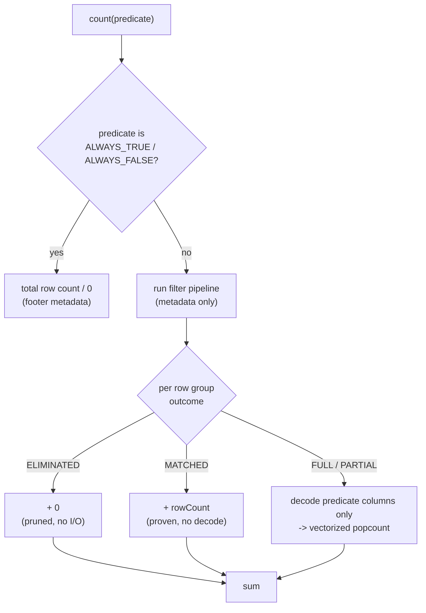

# Counting

!!! abstract "In short"
    `count` returns the number of matching rows without building them.
    Where the metadata proves that none or all of the rows of a row group match, it answers without decoding; elsewhere it decodes the filter columns only and counts the matches.
    It returns the same number as counting the rows of a read.

This page explains how `count(predicate)` returns the number of matching rows
without materializing them, and why it costs much less than reading the rows.
It is for developers counting rows, for example the feature count of a GeoTools
layer.

Counting reuses the filter pipeline and the row-group outcomes described in
[The read path](read-path.md).

The guiding rule: **count proves what it can from statistics and counts the rest
with a columnar popcount: it never materializes a record.** A `read().count()`
decodes the surviving rows into `ParquetRecord` objects only to drop them.
`count()` does none of that.

---

## 1. What count is

`ParquetFileReader.count(predicate, options)` returns how many rows satisfy
`predicate`. It is the answer to a GeoTools `getCount(Query)`, a `SELECT count(*)
WHERE ...`, or any "how many" that does not need the rows themselves.
[Count the matching rows](../guides/filter.md#count-the-matching-rows) shows a
call.

The result equals `read(predicate).count()`: same rows, same number. Only the
work differs. The read path already classifies the row groups by their
filter-pipeline outcome, and count answers two of those outcomes from metadata
alone.

---

## 2. The three routings

`count()` runs the same metadata-only filter pipeline as `read()`, then routes
each row group by its [outcome](read-path.md#4-filtering-the-five-tiers). Two of
the four outcomes are answered without decoding a column.

| Outcome | Contributes | Cost |
|---------|-------------|------|
| `ELIMINATED` | `0` | none - the pipeline already proved no row matches |
| `MATCHED` | `rowCount()` | metadata only: statistics proved that all rows match |
| `FULL` / `PARTIAL` | popcount of the matches | decode the predicate columns only, then count columnar |

A whole-file `ALWAYS_TRUE` short-circuits to the summed row counts before the
pipeline runs, and `ALWAYS_FALSE` returns `0`. Only the residual `FULL` / `PARTIAL`
row groups touch column data, and even then only the predicate's columns: never
an output projection, never a `ParquetRecord`.

---

## 3. Proving a whole row group matches

`ELIMINATED` means that no row matches: it is how the pipeline prunes.
`MATCHED` is its mirror image: all rows match. A proven row group contributes
its row count with zero decode.

The proof lives in the STATS tier. `StatsEvaluator` returns one of four verdicts
per row group: `Eliminated`, `PassedAll`, `Inconclusive` (the statistics leave
some rows undecided) or `NotApplied` (no statistics to consult). The pipeline
promotes a STATS `PassedAll` to the `MATCHED` outcome and skips the later tiers,
as it does for `Eliminated`. For example `year > 5` is
`PassedAll` when the row group's `min(year)` is already above 5.

Because `MATCHED` makes the read path **skip evaluation** (count adds the row
count, and `read()` returns the rows without re-testing them), the proof has to be
sound, not just useful. A false `MATCHED` would overcount. The rule
`boundsCoverEachRow` admits a comparison proof only when:

- **`nullCount == 0`.** A null never satisfies a comparison. A column with any
  null cannot be all-match (`year > 5` is false for a null `year`).
- **the bounds cover each cell:** `BOOLEAN`, `INT32` and `INT64` always. `FLOAT` and
  `DOUBLE` only when the writer recorded a NaN count of zero: `NaN` cells lie outside
  min/max, and under IEEE 754 an ordered comparison never matches them. Binary
  (`BYTE_ARRAY` / `FIXED_LEN_BYTE_ARRAY`) is excluded because its statistics may be
  truncated, leaving the stored max below the true max.

One proof does not go through the bounds. A `FLOAT` or `DOUBLE` row group holds
nothing but `NaN` when the writer recorded a NaN count and a null count adding up
to its values. With `nullCount == 0` each row then matches `x = NaN` and
`x <> 1.0`, and the row group is `MATCHED`. NaN bounds alone prove nothing: a
writer taking the min and the max over the `NaN` cells as well records NaN bounds
for a row group holding numbers.

Two more conservative edges: a missing null count fails the `== 0` test, and an
empty row group (`rowCount == 0`) is never promoted to `MATCHED`. When in doubt
the verdict is `Inconclusive` or `NotApplied`, and the row group falls through
to the residual count: slower, never wrong.

`MATCHED` is a shared outcome, not a count-only one. On the read path, a
`MATCHED` row group streams its rows without running the per-row record filter
(see [The read path](read-path.md#4-filtering-the-five-tiers)).

---

## 4. Counting the residual: a columnar popcount

A `FULL` or `PARTIAL` row group is a row group not settled by the statistics.
Its rows must be tested. Count does this without building a single record. It
decodes the predicate's columns into the usual columnar `ParquetRecordBatch`,
then
`VectorizedPredicateEvaluator` turns the predicate into a `BitSet` of matching
rows. The count is that bitset's `cardinality()`.

- **`IsNotNull` is a pure popcount** over the column's validity mask;
  `IsNull` is its complement. No value is compared.
- **A comparison scans the typed primitive array** (`int[]`, `long[]`, `double[]`,
  ...), sets a bit where the comparison holds, and intersects with validity - a
  null row is structurally excluded, matching the record-level rule.
- **`And` / `Or` / `Not`** are `BitSet` intersection / union / complement of the
  child masks.

The evaluator is held to the same semantics as the row-by-row
`RecordLevelEvaluator`: both route their comparisons through the shared
`ValueComparison` core (one definition of type coercion and Parquet's unsigned
binary ordering). A residual count and a `read().count()` therefore agree on
boundary values. The difference is only the shape of the work - a tight columnar
scan and a popcount instead of per-row record assembly.

---

## 5. What it costs

The JMH benchmark `CountBenchmark`, in `internal/parquetry-benchmarks`, times
`count()` against a `read(predicate).count()` baseline. Its file holds 1M rows,
with a sorted `id` column without nulls and 100k rows per row group. It shows
three regimes:

- **Proven paths go from O(rows) to O(row groups).** When statistics decide the
  whole file (`ALWAYS_TRUE`, `MATCHED`, an `IsNotNull` on a column without
  nulls), count decodes no column, and its cost follows the number of row
  groups. The baseline scans the rows. A layer's feature count is often in this
  case.
- **The residual path decodes less.** It decodes only the predicate columns and
  counts in columnar form instead of materializing records.
- **`ELIMINATED` costs the same.** `read()` already drops fully pruned row
  groups from statistics, and there is no decode to save.

---

## 6. Edges and limits

- **Spatial predicates** are lowered before counting exactly as they are before
  reading (covering-column comparisons where the file supports them, or the WKB
  envelope test where it does not). A bbox count reuses the pruning described in
  [Spatial filtering](spatial-filtering.md).
- **Null correctness** is identical to the read path: comparisons exclude nulls,
  `IsNull` / `IsNotNull` are decided purely by the validity mask.

---

## 7. Where to look

Paths are relative to the `io/tileverse/parquetry` package of `parquetry-core`.

| Concern | Start in |
|---------|----------|
| Count entry + routing | `data/ParquetFileReader.java` (`count`) |
| Columnar popcount sink | `internal/read/BatchPipeline.java` (`countMatching`) |
| Predicate -> matching `BitSet` | `columnar/VectorizedPredicateEvaluator.java` |
| Shared comparison core | `internal/filter/ValueComparison.java` |
| All-match proof | `internal/filter/StatsEvaluator.java` (`PassedAll`), `internal/filter/LeafVerdicts.java` (`boundsCoverEachRow`) |
| MATCHED outcome + short-circuit | `filter/explain/RowGroupOutcome.java`, `internal/filter/FilterPipeline.java` |
| Benchmarks | `internal/parquetry-benchmarks/.../CountBenchmark.java` |

---

*Scope: counting rows over a single Parquet / GeoParquet file. The dataset-level
count over many files (the catalog facade used by GeoServer) delegates to this
per-file count. The general read path is in [The read path](read-path.md).
Spatial filtering is in [Spatial filtering](spatial-filtering.md).*
