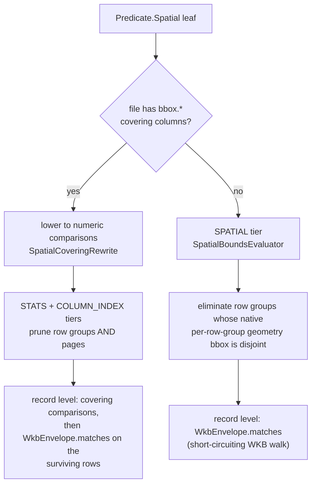

# Spatial filtering

!!! abstract "In short"
    A bounding box filter compares the bounding box of each geometry with the query box, and its result is exact for that comparison.
    Parquetry skips row groups and pages with the `bbox` covering columns of a file, and row groups with its GeoParquet 2.0 bounds, then tests the remaining rows.
    An exact geometry test, such as a true intersection, runs on the rows left by that pruning.

This page explains how a spatial predicate on a GeoParquet geometry column
turns into pruned row groups, skipped pages and an exact per-row test. It is for
developers filtering GeoParquet by location, and for operators who want to know
which files prune well.

Spatial filtering is part of the read path: read [The read path](read-path.md)
first for the four stages of a read.

The guiding rule: **the bbox relations compare the 2D bounding box of the
geometry only.** They are rectangle relations, evaluated exactly. A
true geometry test, such as a real intersects against the curve and not its
envelope, goes through a geometry engine behind the `GeometryFilter<T>` SPI
([section 6](#6-the-bbox-only-contract)).

---

## 1. The predicate family

The predicate ADT exposes a closed family of four bbox relations under the sealed
`Predicate.Spatial`. Each compares the geometry's 2D bounding box against a query
`Bbox`, edges inclusive, Z ignored.

| Relation | True when the geometry's bbox ... | Builder |
|----------|-----------------------------------|---------|
| `BboxIntersects` | overlaps the query box | `Pred.col("geometry").bboxIntersects(q)` |
| `BboxContains` | encloses the query box | `Pred.col("geometry").bboxContains(q)` |
| `BboxCoveredBy` | is enclosed by the query box | `Pred.col("geometry").bboxCoveredBy(q)` |
| `BboxEquals` | matches the query box on all four edges | `Pred.col("geometry").bboxEquals(q)` |

The query box is a `Bbox`: `Bbox.of2d(minX, minY, maxX, maxY)` (or `of3d(...)`,
though the relations compare X/Y only). The family is closed on purpose: each
relation in it has an exact evaluation. There are no `DWithin`, `Within` or
`Overlaps` stubs returning wrong rows.

---

## 2. Using it

A spatial read is an ordinary `read()` with a spatial predicate. The geometry
column is decoded for the filter even when it is outside the projection.
[Filter by location](../guides/spatial-filter.md) shows such a read.

A spatial predicate composes with the rest of the ADT: `And` / `Or` with
attribute predicates, and `Not` around a spatial relation, behave as usual
(see [section 5](#5-null-geometries) for the one subtlety, null geometries).

---

## 3. How it filters

A spatial predicate is filtered at three levels, cheapest first, in the same
"filter, then fetch, then decode" order as other predicates. The statistics
present in the file decide which row-group and page levels apply
([section 4](#4-which-path-applies)).

**Record level - the exact test.** `WkbEnvelope.matches` walks the geometry's WKB
and decides the relation while it reads, stopping as soon as the answer is fixed:
`BboxIntersects` / `BboxContains` return true the moment the running envelope
satisfies the relation; `BboxCoveredBy` returns false on the first vertex outside
the query; `BboxEquals` needs the full envelope. The walk is shared with the
write-side statistics accumulator; one WKB parser serves both sides.

The walk accepts both WKB type-code encodings: ISO (Z/M/ZM via the
`+1000`/`+2000`/`+3000` offsets) and EWKB (Z/M via the `0x80000000`/`0x40000000`
high-bit flags, as JTS and PostGIS write them). An EWKB `0x20000000` SRID flag is
recognized and its 4-byte payload skipped. Per the parquet-format spec, the
`geospatial_types` recorded in the written statistics are always normalized to ISO
codes, whatever the encoding of the input.

**Row-group and page pruning** comes from one of two mechanisms:

- **Covering-column lowering.** A GeoParquet file with a `bbox` covering (1.1 or
  2.0) stores a box enclosing each row's geometry in four `bbox.*` sidecar
  columns. GeoParquet allows that box to be wider than the geometry's own
  bounding box, and Parquetry's FLOAT covering rounds its bounds outward. A
  relation lowers to the comparisons on those columns satisfied by the matching
  rows, a necessary condition rather than an equivalent. `BboxIntersects(q)` and
  `BboxCoveredBy(q)` lower to an overlap test,
  `xmin <= q.maxX AND xmax >= q.minX AND ymin <= q.maxY AND ymax >= q.minY`.
  `BboxContains(q)` and `BboxEquals(q)` lower to a test that the covering
  encloses the query box. `SpatialCoveringRewrite` adds that conjunction beside
  the spatial leaf at read time, and the existing STATS and COLUMN_INDEX tiers
  prune row groups *and* pages from the sidecar columns' statistics. Page
  pruning needs a column index on those columns, or pages learned from their
  page headers by an earlier read
  ([Without a page index](read-path.md#without-a-page-index)). The spatial leaf
  stays in the predicate and decides the surviving rows from their geometry
  WKB. That test keeps the answer exact.
- **Native row-group bounds.** A GeoParquet 2.0 file stores a per-row-group
  geometry bounding box in the column chunk's statistics. The `SPATIAL` tier
  (`SpatialBoundsEvaluator`) eliminates a row group whose box is disjoint from the
  query (`BboxContains` instead keeps only groups whose box can enclose the
  query). This is row-group granularity only - native statistics are per chunk,
  not per page.

---

## 4. Which path applies

The two pruning mechanisms target different files, and a single read picks the
mechanism supported by the file:

| The file has ... | Row-group pruning | Page pruning | Record-level test |
|------------------|-------------------|--------------|-------------------|
| `bbox.*` covering columns (GeoParquet 1.1 or 2.0) | yes (lowered comparisons) | yes, with a column index or learned pages | covering comparisons, then `WkbEnvelope.matches` on the WKB |
| native per-row-group geometry stats only (GeoParquet 2.0) | yes (SPATIAL tier) | no | `WkbEnvelope.matches` on WKB |
| neither | no | no | `WkbEnvelope.matches` on WKB |

A file with a covering takes the lowering path, whatever the GeoParquet version
declared in its geo document. It prunes pages too, from the first read when its
covering columns have a column index. Without one, pruning starts at the second
read of a row group, when that read scans only learned columns. A GeoParquet 2.0
file without a covering takes the native path, at row-group granularity. With no
usable statistics, nothing is pruned and the result is still exact: the
record-level test decides the rows.

Parquetry's writer emits both by default: native per-row-group geometry
statistics and a `bbox` covering.
[Write a GeoParquet file](../guides/write.md#write-a-geoparquet-file) lists the
options.

Pruning is conservative everywhere: a row group or page is dropped only when its
statistics prove no row in it can match; pruning never changes which rows a
read returns, only how much work it does. Spatial clustering is what makes it pay
off; a file whose geometries are spread evenly across row groups prunes little.

---

## 5. Null geometries

A null (absent) geometry has no bounding box and therefore no spatial truth value.
Under OGC simple-feature semantics a relation against it is unknown, and a `WHERE`
keeps a row only when the predicate is true. A null-geometry row is excluded
from a spatial predicate **and from its negation** - the same way `col = v` and
`col <> v` both exclude a null `col`:

| geometry | `bboxIntersects(q)` | `NOT bboxIntersects(q)` |
|----------|---------------------|--------------------------|
| present, overlaps | kept | dropped |
| present, disjoint | dropped | kept |
| null | dropped | dropped |

A predicate and its negation are not complementary when nulls are present; the
null rows fall out of both. This only matters for an optional geometry column - a
required geometry never triggers it.

---

## 6. The bbox-only contract

The four relations compare bounding boxes, not geometries. For a polygon query
they answer "could these interact?", not "do these shapes actually intersect?".
That coarse answer is exactly what a spatial index gives, and it is enough to
prune the read down to a small candidate set.

True-geometry filtering, such as a real intersection against the curve, needs a
geometry engine. The materializer decoding WKB into a geometry object is
output-only, and it never runs in the filter path.

The exact test runs either in the consumer, on the candidates returned by a bbox
relation, or inside the read, as a `GeometryFilter<T>`
(`filter/GeometryFilter.java`). A geometry filter provides a sound bbox lowering
for coarse pruning plus an exact `matches` test. The reader prunes with the
lowering, then runs the exact test per surviving row, dropping non-matches
before their other columns materialize. `parquetry-core` ships
`JtsGeometryFilter` (package `io.tileverse.parquetry.geo`) over the JTS topology
predicates. A geometry filter in the read decodes each surviving geometry once
for the test, and output materialization decodes the WKB again.
[Apply an exact geometry test](../guides/spatial-filter.md#apply-an-exact-geometry-test)
shows both ways.

---

## 7. Where to look

Paths are relative to the `io/tileverse/parquetry` package of `parquetry-core`.

| Concern | Start in |
|---------|----------|
| Predicate family + builders | `filter/Predicate.java` (`Predicate.Spatial`), `filter/Pred.java` |
| Query box + 2D relations | `filter/Bbox.java` |
| Shared WKB walk + exact match | `internal/filter/spatial/WkbEnvelope.java` |
| Record-level evaluation | `internal/filter/RecordLevelEvaluator.java` |
| Covering-column lowering | `internal/filter/spatial/SpatialCoveringRewrite.java` |
| Native row-group pruning | `internal/filter/SpatialBoundsEvaluator.java`, `filter/explain/Tier.java`, `internal/filter/spatial/SpatialBoundsSource.java` |
| Exact geometry gate (SPI) | `filter/GeometryFilter.java`, `Predicate.geometryFilter(...)` |
| JTS-backed exact filter | `geo/JtsGeometryFilter.java` |
| Benchmarks | `internal/parquetry-benchmarks/.../SpatialPruningBenchmark.java`, `SpatialGateBenchmark.java`, `JtsSpatialFilterBenchmark.java` |

---

*Scope: bbox-based spatial filtering over a GeoParquet geometry column. True
geometry materialization (WKB to a JTS geometry) is in `parquetry-core`, in the
`io.tileverse.parquetry.geo` package. The general read path is in
[The read path](read-path.md).*
