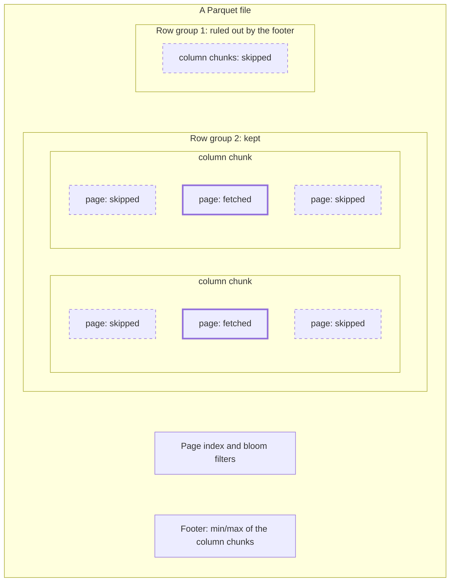

# Parquetry

{ .banner }

Parquetry reads and writes Apache Parquet and GeoParquet files from Java. Give it a file and a filter, and it returns the matching rows. The file can sit on a local disk, an HTTP server, Amazon S3, Azure Blob Storage or Google Cloud Storage, and Parquetry fetches only the parts of it needed by the query. It runs inside long-lived servers with small container memory limits, such as GeoServer and GeoServer Cloud, and sizes its memory from that limit.

[Why Parquetry?](why.md) explains the deployment targeted by Parquetry, and when another tool fits better. [Getting started](getting-started.md) adds Parquetry to a Java project and runs a first filtered read.

## What you can do

-   **Publish a GeoParquet file as a map layer**

    ---

    Publish GeoParquet files from object storage or a mounted volume as vector layers of GeoServer Cloud, through its REST API. The Parquetry store is enabled by default.

    [GeoParquet in GeoServer Cloud](https://geoserver.org/geoserver-cloud/user-guide/geoparquet-rest-api/) or [GeoTools and GeoServer](geoserver/index.md)

-   **Query a remote file by bounding box from Java**

    ---

    Give a read a bounding box, and it returns the rows whose geometry has a bounding box overlapping it. The read fetches the parts of the file able to hold such rows, and leaves the rest on the server.

    [Cloud storage](guides/cloud-storage.md) then [Filter by location](guides/spatial-filter.md)

-   **Hand a layer to an analytics engine**

    ---

    Download a vector layer of GeoServer Cloud as a GeoParquet file or an Arrow IPC stream through WFS, and read it with DuckDB or with Python. From Java, Parquetry exports a read as Arrow.

    [WFS output as GeoParquet and Arrow IPC](https://geoserver.org/geoserver-cloud/user-guide/wfs-geoparquet-arrow-ipc/) or [Arrow interop](guides/arrow.md)

## Selective queries read little

A Parquet file stores its rows in blocks called row groups. Inside a row group, the values of a column sit together in a column chunk, cut into pages. The footer at the end of the file describes the row groups and records the minimum and maximum of their column chunks. A page index, when the file has one, records the position, minimum and maximum of the pages. A bloom filter, when the file has one, tells whether a value may appear in a column chunk.

Parquetry reads this metadata before it fetches any data, and skips the parts of the file unable to match the filter. The diagram shows a small bounding box query on a file sorted by location.

The levels run in this order:

1. The statistics in the footer rule out row groups.
2. The GeoParquet 2.0 geometry statistics, also in the footer, rule out the row groups whose geometries lie outside a bounding box.
3. The page index rules out pages in the row groups left.
4. Bloom filters rule out the row groups lacking the value of an `eq` or `in` filter.
5. The read fetches the pages left, of the columns needed by the query, and tests their rows one by one. It returns the matching rows only.

A GeoParquet file written by Parquetry has a page index and `bbox` covering columns, four columns holding the bounding box of each geometry. For a small bounding box over such a file sorted by location, the statistics of the covering columns rule out the row groups far from the box. Their page index rules out the pages far from it in the row groups left, and the read fetches the few pages near the box.

The footer is read once per file. The page index and the bloom filters are read only for the row groups left by the levels before them. The levels work from the metadata of the file, and a file without it is pruned less. A read learns the pages of a file without a page index from their headers, and later reads of a row group prune pages with them ([Without a page index](concepts/read-path.md#without-a-page-index)). The per-row test keeps the result exact. [Filter rows](guides/filter.md) and [Filter by location](guides/spatial-filter.md) show the filters, and [The read path](concepts/read-path.md) follows a filtered read through these levels.

## How it is built

Parquetry is a clean-room implementation of the Parquet format in Java: it depends on neither Hadoop nor parquet-java, and it runs no native engine. It reads files through [tileverse-storage](https://tileverse.io/storage/), and its [architecture diagrams](developer-guide/architecture.md) show the modules and how a read flows through them. [Format support](reference/format-support.md) lists the Parquet and GeoParquet features read and written by Parquetry.

## Status

Parquetry has not reached 1.0, and its API may still change before then. The stable parts are ready for production use. The experimental parts work, but their behavior is still changing.

| Area | Module | Status |
| :--- | :--- | :--- |
| [Reading Parquet files](guides/read-records.md), with [filter pushdown](guides/filter.md) | `parquetry-core` | stable |
| [Writing Parquet files](guides/write.md), Parquet 2.0 by default and 1.1 on request | `parquetry-core` | stable |
| [GeoParquet 1.x and 2.0 metadata](guides/geoparquet.md), [spatial filtering](guides/spatial-filter.md) | `parquetry-core` | stable |
| [Multi-file datasets](guides/datasets.md): a directory or a glob of files read as one dataset | `parquetry-catalog` | stable |
| [GeoTools data store](geoserver/geotools-datastore.md) for GeoParquet | `parquetry-geotools` | stable |
| [Export to Arrow](guides/arrow.md): Arrow IPC streams and the Arrow C Data Interface | `parquetry-arrow` | stable |
| [Reading Apache Iceberg tables](experimental/iceberg.md) | `parquetry-iceberg` | experimental |
| [Reading STAC GeoParquet collections](experimental/stac.md) | `parquetry-stac` | experimental |
| [The `par` command line tool](cli/index.md) | `par` | experimental |

Two supporting modules have no status of their own. `parquetry-avro` reads and writes Avro container files, the format of Iceberg manifests and manifest lists. `parquetry-jackson` renders the rows of a read as JSON.

## In GeoServer Cloud

GeoServer Cloud 3.1.0 and newer include Parquetry ([GeoServer Cloud](geoserver/geoserver-cloud.md)). The Parquetry extension, its "Parquet" data store, and the `geoparquet` and `arrow-ipc` WFS output formats are enabled by default. The Iceberg and STAC GeoParquet stores are not ready for production yet, and ship disabled. The GeoServer Cloud user guide covers both uses:

- [GeoParquet through the REST API](https://geoserver.org/geoserver-cloud/user-guide/geoparquet-rest-api/) publishes GeoParquet files as layers.
- [WFS output as GeoParquet and Arrow IPC](https://geoserver.org/geoserver-cloud/user-guide/wfs-geoparquet-arrow-ipc/) downloads any vector layer as a GeoParquet file or an Arrow IPC stream, regardless of its store.

## Part of the Tileverse ecosystem

Parquetry is part of [Tileverse](https://tileverse.io), a set of Java libraries for cloud-native geospatial applications. Its storage layer, tileverse-storage, provides the byte-range reads and the caches used by Parquetry.
